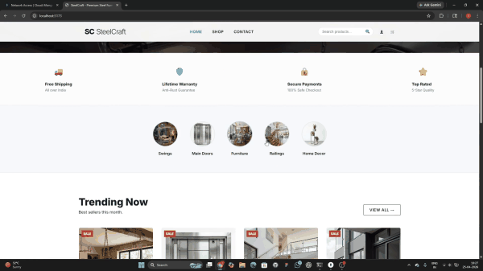

<div align="center">

# SteelCraft

**Full-Stack Architectural Stainless Steel Catalog & Custom Fabrication Inquiry Engine**

[](https://steelfurniture.vercel.app)
[](docs/assets/walkthrough.mp4)
[](https://react.dev/)
[](https://expressjs.com/)
[](https://www.mongodb.com/)
[](LICENSE)

<br />

<!-- Responsive Media Showcase -->
<a href="docs/assets/walkthrough.mp4" target="_blank" rel="noopener noreferrer">
  
</a>

<p align="center">
  <sub>Live preview • <a href="docs/assets/walkthrough.mp4"><b>Watch Full 1080p Video Walkthrough (1:20)</b></a> • <a href="https://steelfurniture.vercel.app"><b>Open Production Deployment</b></a></sub>
</p>

</div>

---

## Overview

SteelCraft is a full-stack architectural engineering and e-commerce platform developed for high-grade T304 stainless steel fabrication, interior products, and industrial installations.

The platform bridges consumer catalog browsing with direct manufacturer procurement workflows. It features live multi-attribute filtering, high-resolution multi-angle product inspection, client-side cart synchronization, and an asynchronous inquiry pipeline for custom architectural dimensions.

---

## System Architecture

```
┌────────────────────────────────────────────────────────┐
│               Client Application Layer                 │
│              (React 18 + Vite Bundler)                 │
│                                                        │
│  ┌──────────────────┐  ┌────────────────────────────┐  │
│  │ Live Filter / UI │  │ Cart State (LocalStorage)  │  │
│  └────────┬─────────┘  └─────────────┬──────────────┘  │
└───────────┼──────────────────────────┼─────────────────┘
            │                          │
            │ REST API Requests (JSON) │
            ▼                          ▼
┌────────────────────────────────────────────────────────┐
│             Express 5 RESTful API Gateway              │
│                                                        │
│  ┌─────────────────┐   ┌─────────────────┐   ┌──────┐  │
│  │ CORS Middleware │──▶│ JSON Body Parser│──▶│ Router│ │
│  └─────────────────┘   └─────────────────┘   └──┬───┘  │
│                                                 │      │
│  ┌──────────────────┐   ┌─────────────────┐     │      │
│  │ /api/products    │   │ /api/orders     │◀────┤      │
│  │ /api/messages    │   │ Error Middleware│◀────┘      │
│  └────────┬─────────┘   └─────────────────┘            │
└───────────┼────────────────────────────────────────────┘
            │
    Mongoose ODM Driver
            │
            ▼
┌────────────────────────────────────────────────────────┐
│             MongoDB Database Cluster                   │
│         (Products, Orders, Custom Messages)            │
└────────────────────────────────────────────────────────┘
```

---

## Engineering Highlights

### 1. Modern Express 5.x Backend Architecture
- Engineered on **Express 5**, leveraging standardized async route handling and modern middleware signatures.
- Dedicated resource routers isolate catalog retrieval (`routes/products.js`), order creation (`routes/orders.js`), and fabrication inquiries (`routes/messages.js`).
- CORS whitelist enforcement ensures secure client-server communication between decoupled frontend and backend domains.

### 2. Multi-Attribute Catalog Search & Real-Time Querying
- Client-side filtering executes sub-millisecond lookups across 24+ stainless steel products categorized across Swings, Safety Doors, Railings, Furniture, and Wall Art.
- Instant search input supports real-time substring matching on product titles, categories, and technical descriptions with dynamic thumbnail previews.

### 3. Inspection View & Multi-Angle Asset Switching
- Product inspection view provides multi-angle asset switching with zero layout shift.
- Dynamic unit pricing calculates real-time quantity adjustments and displays commercial bulk pricing discounts.
- Persistent shopping cart state utilizes `localStorage` with automated schema validation on startup.

### 4. Custom Fabrication Inquiry Pipeline
- Custom inquiry dispatch mechanism captures custom architectural specifications (dimensions, steel grades, surface finish options) directly to MongoDB for manufacturer estimation.

---

## Database Schema & Data Models

| Model | Schema File | Key Attributes | Purpose |
| :--- | :--- | :--- | :--- |
| **Product** | `models/Product.js` | `name`, `price`, `category`, `desc`, `images` (array), `featured` (boolean) | Master catalog items and asset references |
| **Order** | `models/Order.js` | `items` (array), `totalAmount`, `customerInfo` (name, address, phone), `status` | Direct retail order processing |
| **Message** | `models/Message.js` | `name`, `email`, `phone`, `subject`, `message`, `createdAt` | Custom fabrication & architectural inquiries |

---

## API Specification

| Method | Endpoint | Request Body | Description |
| :--- | :--- | :--- | :--- |
| `GET` | `/api/products` | None | Fetch all catalog products with category metadata |
| `POST` | `/api/orders` | `{ items, totalAmount, customerInfo }` | Submit retail purchase order |
| `POST` | `/api/messages` | `{ name, email, phone, message }` | Dispatch custom architectural fabrication inquiry |

---

## Technology Stack

| Layer | Technology | Specification / Purpose |
| :--- | :--- | :--- |
| **Frontend** | React 18, Vite 4 | Fast client-side rendering with reactive UI state |
| **Styling** | Vanilla CSS Design Tokens | Strict 8pt spacing grid, CSS variables, hardware-accelerated transitions |
| **Server** | Node.js, Express 5 | High-efficiency asynchronous REST API server |
| **Database** | MongoDB with Mongoose ODM | Flexible document schema with strict field typing |
| **Deployment** | Vercel | Global edge network hosting |

---

## Project Structure

```
SteelCraft/
├── docs/
│   └── assets/              # Walkthrough media, GIF preview, and poster assets
├── public/
│   └── images/              # Optimized product catalog imagery and video assets
├── src/
│   ├── App.jsx              # Application component routing and view controller
│   ├── api.js               # Centralized API client functions
│   ├── main.jsx             # React DOM root bootstrapping
│   └── styles.css           # Global design tokens and responsive layout styles
├── models/
│   ├── Product.js           # Mongoose Product Schema
│   ├── Order.js             # Mongoose Order Schema
│   └── Message.js           # Mongoose Custom Inquiry Schema
├── routes/
│   ├── products.js          # Catalog endpoint controller
│   ├── orders.js            # Order management endpoint controller
│   └── messages.js          # Inquiry dispatch controller
├── server.js                # Express 5 server initialization and middleware stack
├── vite.config.js           # Vite development and production configuration
├── .env.example             # Environment variable template
└── README.md
```

---

## Installation & Setup

### Prerequisites
- Node.js (v18.0 or higher)
- MongoDB Connection (Local or Atlas URI)

### 1. Clone the Repository
```bash
git clone https://github.com/sahaniTripurari/Steel_Funiture_web.git
cd Steel_Funiture_web
```

### 2. Install Dependencies
```bash
npm install
```

### 3. Configure Environment Variables
Copy `.env.example` to create your local `.env` file:
```bash
cp .env.example .env
```
Populate `.env`:
```env
PORT=5000
MONGO_URI=your_mongodb_connection_string
FRONTEND_URL=http://localhost:5173
```

### 4. Run Development Server
- **Start Backend API:**
  ```bash
  node server.js
  ```
- **Start Frontend Client (in a separate terminal):**
  ```bash
  npm run dev
  ```

Frontend will run at `http://localhost:5173` connecting to the backend at `http://localhost:5000`.

---

## Author & Contact

**Sahani Tripurari** — Full-Stack Software Developer  
- **GitHub**: [@sahaniTripurari](https://github.com/sahaniTripurari)  
- **Email**: sahanitrirpurari@gmail.com  
- **Production URL**: [https://steelfurniture.vercel.app](https://steelfurniture.vercel.app)

---

## License

This project is licensed under the [MIT License](LICENSE).
